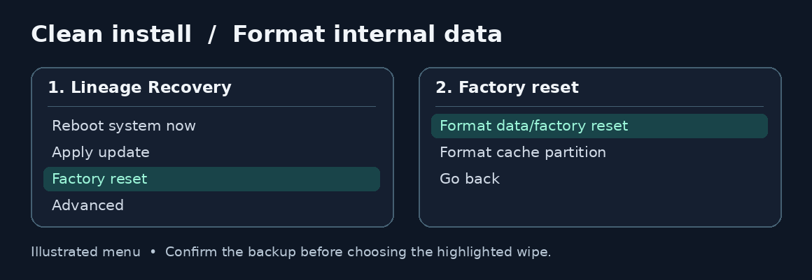
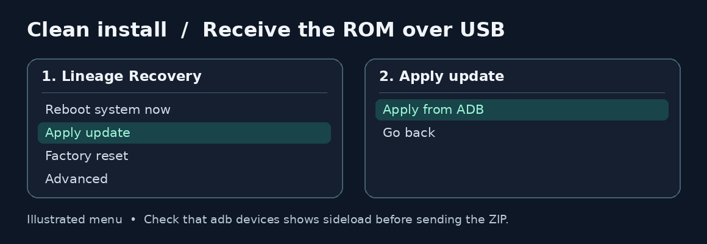

# Install or update LineageOS 24.0 on the Canadian LG G8

**Before downloading, check the phone.** This guide is for the Canadian **LG G8 ThinQ LM-G820UM2** with Canadian LG Android 12 **G820UM40b** firmware. On stock Android, check the model and software version in **Settings → About phone**. If the phone already runs a custom ROM, use your stock installation records to confirm 40b. A generic `LG G8` or `LM-G820` label alone is insufficient. If you cannot confirm the exact variant, firmware, or unlocked bootloader, pause before flashing. [Firmware and model details](COMPATIBILITY.md)

## 1. Pick the row that matches your phone

| What is on the phone now? | What to do |
| --- | --- |
| This fork, release-key build **1795454921** | [Use the local update option](#c-install-an-update-from-the-same-signing-family). This route is designed to keep your apps and data. |
| This fork, build **1795533156** | You already have the build on this page. |
| Another LineageOS build on 40b with working Lineage Recovery | [Prepare for a clean install](#b-start-from-another-lineageos-build). Formatting erases apps and internal storage. |
| Stock LG Android | [Read the stock prerequisites first](#a-start-from-lg-stock-android). A locked or unidentified G8 needs device-specific preparation. |

**Back up before either route.** Copy photos, Downloads, chat backups, and account recovery information off the phone. Check that you can open your backup and sign in again. A clean install erases internal storage. If coming from stock, remove the Google account on the phone after your backup and recovery checks to avoid Factory Reset Protection.

## 2. Download and verify the files

| Download | When |
| --- | --- |
| [ROM ZIP](https://github.com/Magicolo/lg-g8-lineageos/releases/download/v1.1.0/lineage-alphaplus_lao_com-1795533156.zip) | Required. This is a single ZIP. Leave it zipped. |
| [SHA256SUMS](https://github.com/Magicolo/lg-g8-lineageos/releases/download/v1.1.0/SHA256SUMS) | Required to check the download. |
| [Google Apps ZIP](https://github.com/Magicolo/lg-g8-lineageos/releases/download/v1.1.0/MindTheGapps-17.0.0-arm64-20261022_132445.zip) | Optional for a **clean install** if you want the Play Store and Google services. Leave it zipped. |
| [Windows tools](https://github.com/Magicolo/lg-g8-lineageos/releases/download/v1.1.0/LG-G8-Windows-tools.zip) | Download if you will install using Windows and USB. Open `platform-tools` inside the extracted folder. |

For a USB install from macOS or Linux, download [Google's Platform-Tools](https://developer.android.com/tools/releases/platform-tools) for your operating system.

The ROM ZIP is the only file sent to Updater. A normal install from working Lineage Recovery on 40b uses the ROM ZIP and, if wanted, the Google Apps ZIP. Stock firmware, recovery images and rebuild tools are also on this release page. Use those for the advanced paths below.

**Check the SHA-256 before proceeding.** In File Explorer on Windows, open the folder containing your downloads. Click the address bar, type `powershell`, and press Enter. Copy and run the first line. Run the second line only if you downloaded Google Apps.

```powershell
Get-FileHash -Algorithm SHA256 .\lineage-alphaplus_lao_com-1795533156.zip
Get-FileHash -Algorithm SHA256 .\MindTheGapps-17.0.0-arm64-20261022_132445.zip
```

On macOS or Linux, open Terminal in the download folder and use `shasum -a 256 FILENAME`. On Linux, `sha256sum FILENAME` also works. Replace `FILENAME` with the name of the ZIP. Open `SHA256SUMS` in a text editor such as Notepad. The entire hash must match the line for that filename. Uppercase and lowercase letters are equivalent. If a hash differs, download the file again before using it.

The guide pins the exact signed ROM and the optional add-on checked for this build. Compare these values before accepting an expected signer-change prompt.

| Download | Expected SHA-256 |
| --- | --- |
| ROM | `f87fee1e21bc3680feb2f85cb64f9e3242f7d810a19cef969d5cccab1e0989cd` |
| Google Apps | `a6844eeb2613541558237e467b20feb01f8b45b2ebab0109834140ea59b6ca4d` |

## C. Install an update from the same signing family

**Use this for confirmed release-key build 1795454921 of this fork.** The update uses the same project keys. Other ROMs and older test-key versions use the clean-install route.

1. **On the computer**, verify the ROM ZIP as described above. Plug in the phone, choose **File transfer** from the USB notification, and copy the verified ZIP to the phone's **Download** folder. Keep the ZIP intact.
2. **On the phone**, open **Settings → System → Updater**. Tap **⋮ → Install local update** and choose the ROM ZIP from **Download**.
3. When Updater reports **Update imported**, tap the imported build and select **Install**. Keep the phone charged. Wait until Updater offers **Reboot**, then tap it.
4. After reboot, check **Settings → About phone → Android version**. Verify your apps, Wi-Fi, mobile data and ordinary incoming and outgoing calls before clearing your backup. This build keeps the same release key as the earlier device-tested update. [Validation details](VALIDATION.md)

If Updater rejects the package or the signing family is uncertain, keep your data and read [troubleshooting](RECOVERY.md).

## B. Start from another LineageOS build

You need an unlocked Canadian G8 on 40b with **working Lineage Recovery**. The checked migration started from LineageOS 21 on 40b. It used a clean install. Before formatting, compare the ROM ZIP to the hash pinned above. That gives you the exact package whose project signatures were verified. An [independent certificate check](#verify-the-rom-signer-when-changing-builds) is also available.

### Set up USB and reboot into recovery

1. **On the computer**, extract the tools ZIP you downloaded. Open the extracted `platform-tools` folder and confirm you can see `adb.exe` on Windows or `adb` on macOS/Linux. Move the verified ROM ZIP and optional Google Apps ZIP beside it.
2. **On the phone**, enable **Developer options** by tapping **Build number** seven times in **Settings → About phone**. Enable **USB debugging** in **Settings → System → Developer options**. Plug in the unlocked phone with a USB data cable. Tap **Allow** if the phone asks to allow USB debugging.
3. **On the computer**, open PowerShell in the `platform-tools` folder using its address bar. Run the two lines below **one at a time**. Run the second line only when the first lists one device with status `device`. If it shows `unauthorized`, unlock the phone and approve the prompt. If it shows nothing, try another data cable or USB port before continuing. [More USB troubleshooting](RECOVERY.md)

   ```powershell
   .\adb.exe devices
   .\adb.exe reboot recovery
   ```

   On macOS or Linux, open Terminal in the same folder and enter the commands below instead.

   ```bash
   ./adb devices
   ./adb reboot recovery
   ```

4. **On the phone**, wait until the screen says **Lineage Recovery**. A stock LG reset screen or **OPID Mismatched** calls for [recovery troubleshooting](RECOVERY.md).

## Clean install in Lineage Recovery

### 1. Format the phone

**On the phone**, check your external backup one more time. This step erases apps and internal storage. In **Lineage Recovery**, select **Factory reset → Format data/factory reset → Format data**. Wait for the format to succeed. Go back to the main menu. If touch controls do not work, use **Volume** to move and **Power** to select.



### 2. Send the ROM from the computer

**On the phone**, select **Apply update → Apply from ADB**. Leave this screen open.



**On the computer**, in the same `platform-tools` terminal, run the first line. The phone must appear as `sideload`. Then run the second line.

```powershell
.\adb.exe devices
.\adb.exe sideload lineage-alphaplus_lao_com-1795533156.zip
```

On macOS/Linux, use the same commands with `./adb` in place of `.\adb.exe`.

**Read the result on the phone.** Computer progress can stop near **47%** while recovery is still working. Keep the cable connected and let recovery finish. The phone's success message is the signal to move on. If an older recovery asks for explicit permission to install a package signed by this project's different key, choose **Install anyway** only on the documented migration from LineageOS 21, with this guide's exact ROM hash confirmed and no additional recovery error. For a wrong-device, unexpected signer, or failed install error, stop at the recovery screen. [Troubleshooting](RECOVERY.md)

### 3. Decide whether to install Google Apps

- **Without Google Apps**, select **Reboot system now** after recovery reports success.
- **With Google Apps**, stay in recovery. Accept the prompt to **reboot to recovery** to install add-ons. If the prompt is absent, select **Advanced → Reboot to recovery**. In the newly booted recovery, select **Apply update → Apply from ADB** again. Run the command below from the computer. Only the separately verified add-on may show its expected different-signer prompt. Wait for success on the phone before selecting **Reboot system now**.

  ```powershell
  .\adb.exe sideload MindTheGapps-17.0.0-arm64-20261022_132445.zip
  ```

  On macOS/Linux use `./adb`. Finish the add-on step **before the first Android boot**.

### 4. Check the first boot

First boot can take several minutes. Once the welcome screen appears, complete Android setup. In **Settings → About phone → Android version**, look for **Android 17** and **LineageOS 24.0**. Connect to Wi-Fi, check mobile data and place and receive ordinary calls before restoring apps. Keep your backup until everything works. An earlier build in the same signing family was tested on a phone. This exact build passed offline signing and compatibility checks. [Validation details](VALIDATION.md)

## A. Start from LG stock Android

Stock preparation is an advanced path. The [support downloads](https://github.com/Magicolo/lg-g8-lineageos/releases/tag/v1.1.0) include matching stock 40b, Windows tools and `boot.img` for the exact build.

1. Boot the matching Canadian 40b stock firmware at least once. Confirm the model, SIM, calls, data, camera and USB. Preserve a model-specific rollback route.
2. If the bootloader is locked or you cannot establish its state, stop here. A fresh unlock from locked stock was not validated. The [upstream G8 guide](https://lineageos.github.io/lineage_wiki/devices/alphaplus/install/variant1/) documents recovery prerequisites for an already prepared phone.
3. Use the release's matching `boot.img` only if you meet the upstream rooted-recovery prerequisites and have a verified device-specific recovery procedure. Use the [model-specific A/B firmware instructions](https://lineageos.github.io/lineage_wiki/devices/alphaplus/install/variant1/#ensuring-all-firmware-partitions-are-consistent) when preparing both slots. If any stock tool or recovery step fails, pause and use [Troubleshooting](RECOVERY.md).
4. Once your exact model, 40b firmware, and working Lineage Recovery are confirmed, follow [the clean install](#clean-install-in-lineage-recovery). With working recovery, the full OTA writes the necessary partitions.

## Verify the ROM signer when changing builds

Download **ota-release.x509.pem** and **ota-verifier-linux-x86_64.tar.gz** from the [same release](https://github.com/Magicolo/lg-g8-lineageos/releases/tag/v1.1.0). Keep them and the ROM in one folder. Compare the certificate's SHA-256 fingerprint with this value.

```text
5A:50:4C:FC:FE:4C:23:F9:4E:E6:3C:04:B5:29:EA:73:29:81:C5:8E:ED:CB:86:74:BD:E1:8C:87:24:D8:19:44
```

In x86-64 Linux or Ubuntu under Windows Subsystem for Linux, open that folder in the Linux terminal and run these commands.

```bash
openssl x509 -in ota-release.x509.pem -noout -fingerprint -sha256
mkdir -p ota-verifier
tar -xzf ota-verifier-linux-x86_64.tar.gz -C ota-verifier
PATH="$PWD/ota-verifier/bin:$PATH" check_ota_package_signature \
  ota-release.x509.pem lineage-alphaplus_lao_com-1795533156.zip
```

Compare the certificate fingerprint above and look for **Whole package signature VERIFIED** and **Payload signatures VERIFIED**. If the verifier reports a failure, stop before formatting or accepting a recovery warning. [Recovery troubleshooting](RECOVERY.md)
