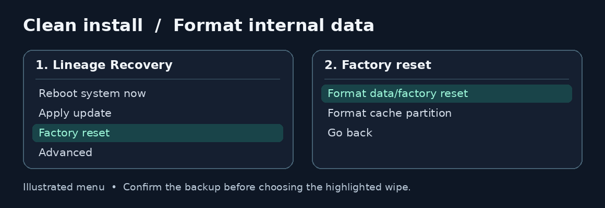
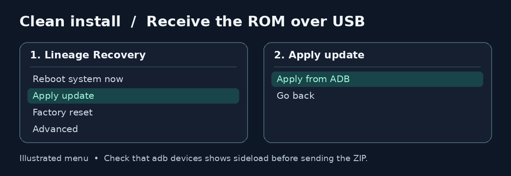

# Start here

This project covers the **Canadian LG G8 ThinQ LM-G820UM2** with LG Android 12 **40b** firmware. Its Android device ID is **alphaplus_lao_com**. Download the complete [v1.1.0 installation kit](https://github.com/Magicolo/lg-g8-lineageos/releases/tag/v1.1.0) for this exact variant.

| What you want to do | Where to go |
| --- | --- |
| Find the release assets and checksums | [Release guide](RELEASES.md#complete-install-kit-v110) |
| Install or update with a complete matching kit | [Installation guide](INSTALL.md) |
| Build the public source | [Build guide](BUILD.md) |
| Understand the call fixes | [IMS engineering guide](IMS.md) and [local inputs](../ims/README.md) |
| Recover from a failed install | [Troubleshooting](RECOVERY.md) |

## Choose the route from the phone's current state

- **Stock LG Android, locked** — Confirm the exact variant's unlock and rollback route before flashing.
- **Stock LG Android, unlocked** — Follow the linked model-specific firmware and recovery instructions before sideloading.
- **Another LineageOS build** — Use the known working recovery and independently verify the Canadian OTA. The tested signer migration uses a clean install.
- **This fork with the same signing key** — Back up, then use Lineage Updater's local update option.

The two illustrations show the clean-install choices after reaching **Lineage Recovery**. Read the [full guide](INSTALL.md) for backup, checksum, signature and Google Apps steps before using either menu.

If the model is uncertain, the checksum differs, or you see **OPID Mismatched**, pause and open the [recovery guide](RECOVERY.md).
